# DER del sistema

Diagrama entidad-relacion de la persistencia SQLite. Las relaciones representan claves foraneas; `o|` indica una referencia opcional y las tablas de detalle resuelven relaciones de muchos a muchos.

```mermaid
erDiagram
    LOCATIONS {
        int id PK
        text code UK
        text name
        text type
    }
    APP_USERS {
        int id PK
        text username UK
        text password_hash
        text role
        int location_id FK
        int active
        text created_at
    }
    AUTH_SESSIONS {
        text token_hash PK
        int user_id FK
        text expires_at
    }
    SUPPLIERS {
        int id PK
        text tax_id UK
        text name
        text phone
        text email
    }
    CATEGORIES {
        int id PK
        text name UK
    }
    PRODUCTS {
        int id PK
        text sku UK
        text name
        text category
        int cost_cents
        int price_cents
        int minimum_stock
        int supplier_id FK
        text tracking_mode
        int category_id FK
    }
    STOCK {
        int location_id PK, FK
        int product_id PK, FK
        int quantity
    }
    INVENTORY_MOVEMENTS {
        int id PK
        text occurred_at
        int location_id FK
        int product_id FK
        int quantity_delta
        text movement_type
        text reference
        int unit_cost_cents
        int cost_is_estimated
        int waste_quantity
    }
    PURCHASE_ORDERS {
        int id PK
        text code UK
        int supplier_id FK
        int destination_id FK
        text status
        text created_at
    }
    PURCHASE_ORDER_LINES {
        int order_id PK, FK
        int product_id PK, FK
        int quantity
        int received_quantity
    }
    PRICE_LISTS {
        int id PK
        text name UK
        int active
        text created_at
    }
    PRICE_LIST_ITEMS {
        int price_list_id PK, FK
        int product_id PK, FK
        int price_cents
    }
    PROMOTIONS {
        int id PK
        text name
        text kind
        int value
        int product_id FK
        text category
        text starts_at
        text ends_at
        int active
    }
    LOTS {
        int id PK
        int location_id FK
        int product_id FK
        text code
        text expiry_date
        int quantity
    }
    SERIAL_NUMBERS {
        int id PK
        int location_id FK
        int product_id FK
        text serial UK
        text status
        int lot_id FK
    }
    REPLENISHMENT_ORDERS {
        int id PK
        text code UK
        int origin_id FK
        int destination_id FK
        int batch_id FK
        text status
        text created_at
    }
    REPLENISHMENT_BATCHES {
        int id PK
        text code UK
        int origin_id FK
        text created_at
    }
    REPLENISHMENT_LINES {
        int order_id PK, FK
        int product_id PK, FK
        int quantity
    }
    PACKAGES {
        int id PK
        text code UK
        int order_id FK
        text dispatch_note UK
        text seal
        text status
        text prepared_at
        text dispatched_at
        text received_at
        int seal_intact
        int dispatch_note_ok
    }
    PACKAGE_LINES {
        int package_id PK, FK
        int product_id PK, FK
        int quantity
    }
    PACKAGE_EVENTS {
        int id PK
        int package_id FK
        text state
        text occurred_at
        text detail
    }
    PACKAGE_UNIT_SERIALS {
        int package_id PK, FK
        int serial_id PK, FK
        int origin_location_id FK
        int origin_lot_id FK
        int destination_lot_id FK
    }
    SALES {
        int id PK
        text receipt UK
        int location_id FK
        text sold_at
        int total_cents
        text state
        int customer_id FK
        int price_list_id FK
        int loyalty_points_earned
    }
    SALE_LINES {
        int id PK
        int sale_id FK
        int product_id FK
        int quantity
        int returned_quantity
        int unit_price_cents
        int unit_cost_cents
        int discount_cents
        int promotion_id FK
    }
    PAYMENTS {
        int id PK
        int sale_id FK
        text method
        int amount_cents
    }
    RETURNS {
        int id PK
        int sale_id FK
        text returned_at
        int total_cents
    }
    RETURN_LINES {
        int id PK
        int return_id FK
        int sale_line_id FK
        int quantity
        int restocked
    }
    RETURN_PAYMENTS {
        int id PK
        int return_id FK
        text method
        int amount_cents
    }
    SALE_LINE_TRACE {
        int id PK
        int sale_line_id FK
        int lot_id FK
        int serial_id FK
        int quantity
    }
    RETURN_LINE_TRACE {
        int id PK
        int return_line_id FK
        int sale_line_trace_id FK
        int quantity
    }
    CUSTOMERS {
        int id PK
        text code UK
        text name
        text phone
        text email
        int credit_limit_cents
        int balance_cents
        int loyalty_points
    }
    INVENTORY_COUNTS {
        int id PK
        text code UK
        int location_id FK
        text status
        text created_at
        text closed_at
    }
    INVENTORY_COUNT_LINES {
        int count_id PK, FK
        int product_id PK, FK
        int expected_quantity
        int counted_quantity
        text trace_detail
    }

    LOCATIONS o|--o{ APP_USERS : assigned_location
    APP_USERS ||--o{ AUTH_SESSIONS : authenticates
    SUPPLIERS o|--o{ PRODUCTS : supplies
    CATEGORIES ||--o{ PRODUCTS : classifies
    LOCATIONS ||--o{ STOCK : stores
    PRODUCTS ||--o{ STOCK : stocked_as
    LOCATIONS ||--o{ INVENTORY_MOVEMENTS : records
    PRODUCTS ||--o{ INVENTORY_MOVEMENTS : moves
    SUPPLIERS ||--o{ PURCHASE_ORDERS : receives
    LOCATIONS ||--o{ PURCHASE_ORDERS : destination
    PURCHASE_ORDERS ||--o{ PURCHASE_ORDER_LINES : contains
    PRODUCTS ||--o{ PURCHASE_ORDER_LINES : ordered
    PRICE_LISTS ||--o{ PRICE_LIST_ITEMS : contains
    PRODUCTS ||--o{ PRICE_LIST_ITEMS : priced_in
    PRODUCTS o|--o{ PROMOTIONS : targets
    LOCATIONS ||--o{ LOTS : holds
    PRODUCTS ||--o{ LOTS : grouped_in
    LOCATIONS ||--o{ SERIAL_NUMBERS : holds
    PRODUCTS ||--o{ SERIAL_NUMBERS : identified_by
    LOTS o|--o{ SERIAL_NUMBERS : tracks
    LOCATIONS ||--o{ REPLENISHMENT_ORDERS : origin
    LOCATIONS ||--o{ REPLENISHMENT_ORDERS : destination
    LOCATIONS ||--o{ REPLENISHMENT_BATCHES : consolidates
    REPLENISHMENT_BATCHES o|--o{ REPLENISHMENT_ORDERS : splits_by_destination
    REPLENISHMENT_ORDERS ||--o{ REPLENISHMENT_LINES : contains
    PRODUCTS ||--o{ REPLENISHMENT_LINES : replenished
    REPLENISHMENT_ORDERS ||--o{ PACKAGES : packed_as
    PACKAGES ||--o{ PACKAGE_LINES : contains
    PRODUCTS ||--o{ PACKAGE_LINES : shipped
    PACKAGES ||--o{ PACKAGE_EVENTS : history
    PACKAGES ||--o{ PACKAGE_UNIT_SERIALS : tracks_units
    SERIAL_NUMBERS ||--o{ PACKAGE_UNIT_SERIALS : assigned_to
    LOCATIONS ||--o{ PACKAGE_UNIT_SERIALS : unit_origin
    LOTS o|--o{ PACKAGE_UNIT_SERIALS : origin_lot
    LOTS o|--o{ PACKAGE_UNIT_SERIALS : destination_lot
    LOCATIONS ||--o{ SALES : records
    CUSTOMERS o|--o{ SALES : buys
    PRICE_LISTS o|--o{ SALES : applies
    SALES ||--o{ SALE_LINES : contains
    PRODUCTS ||--o{ SALE_LINES : sold
    PROMOTIONS o|--o{ SALE_LINES : discounts
    SALES ||--o{ PAYMENTS : paid_by
    SALES ||--o{ RETURNS : returned_through
    RETURNS ||--o{ RETURN_LINES : contains
    SALE_LINES ||--o{ RETURN_LINES : references
    RETURNS ||--o{ RETURN_PAYMENTS : refunded_by
    SALE_LINES ||--o{ SALE_LINE_TRACE : traced_to
    LOTS o|--o{ SALE_LINE_TRACE : lot_source
    SERIAL_NUMBERS o|--o{ SALE_LINE_TRACE : serial_source
    RETURN_LINES ||--o{ RETURN_LINE_TRACE : traces
    SALE_LINE_TRACE ||--o{ RETURN_LINE_TRACE : returned_units
    LOCATIONS ||--o{ INVENTORY_COUNTS : counted_at
    INVENTORY_COUNTS ||--o{ INVENTORY_COUNT_LINES : contains
    PRODUCTS ||--o{ INVENTORY_COUNT_LINES : counted
```

