# Diagrama Entidad-Relación del proyecto

Este DER representa el esquema SQLite usado actualmente por la aplicación
(`sistema/storage.py`), no el modelo conceptual del diagrama de clases objetivo.
Incluye las tablas operativas y sus claves foráneas. `schema_migrations` se
omite porque es una tabla técnica de control de versiones, no del dominio.

```mermaid
erDiagram
    ESTABLISHMENTS {
        INTEGER id PK
        TEXT code UK
        TEXT name
        TEXT type
    }

    SUPPLIERS {
        INTEGER id PK
        TEXT tax_id UK
        TEXT name
    }

    CATEGORIES {
        INTEGER id PK
        TEXT name UK
    }

    PRODUCTS {
        INTEGER id PK
        TEXT sku UK
        TEXT name
        INTEGER category_id FK
        INTEGER cost_cents
        INTEGER price_cents
    }

    PRODUCT_SUPPLIERS {
        INTEGER product_id PK, FK
        INTEGER supplier_id PK, FK
    }

    INVENTORY {
        INTEGER establishment_id PK, FK
        INTEGER product_id PK, FK
        INTEGER quantity
        INTEGER minimum_stock
    }

    INVENTORY_MOVEMENTS {
        INTEGER id PK
        INTEGER establishment_id FK
        INTEGER product_id FK
        TEXT movement_type
        INTEGER quantity_delta
        INTEGER unit_cost_cents
        TEXT reference
        TEXT occurred_at
    }

    REPLENISHMENT_BATCHES {
        INTEGER id PK
        TEXT created_at
    }

    REPLENISHMENT_ORDERS {
        INTEGER id PK
        INTEGER batch_id FK
        INTEGER source_id FK
        INTEGER destination_id FK
        TEXT created_at
        TEXT status
        INTEGER request_id FK
    }

    REPLENISHMENT_LINES {
        INTEGER id PK
        INTEGER order_id FK
        INTEGER product_id FK
        INTEGER requested
    }

    REPLENISHMENT_REQUESTS {
        INTEGER id PK
        INTEGER requester_id FK
        TEXT created_at
        TEXT status
        INTEGER order_id FK
    }

    REPLENISHMENT_REQUEST_LINES {
        INTEGER id PK
        INTEGER request_id FK
        INTEGER product_id FK
        INTEGER requested
        INTEGER fulfilled
    }

    PACKAGES {
        INTEGER id PK
        INTEGER order_id FK
        TEXT dispatch_note UK
        TEXT seal
        TEXT status
        TEXT prepared_at
        TEXT dispatched_at
        TEXT received_at
        TEXT verified_at
    }

    PACKAGE_LINES {
        INTEGER id PK
        INTEGER package_id FK
        INTEGER product_id FK
        INTEGER quantity
    }

    PACKAGE_EVENTS {
        INTEGER id PK
        INTEGER package_id FK
        TEXT state
        TEXT occurred_at
        TEXT detail
    }

    LOGISTICS_AUDIT {
        INTEGER id PK
        INTEGER package_id FK
        TEXT occurred_at
        TEXT state
        TEXT detail
    }

    SALES {
        INTEGER id PK
        INTEGER establishment_id FK
        TEXT sold_at
        TEXT status
        TEXT receipt UK
        INTEGER total_cents
    }

    SALE_LINES {
        INTEGER id PK
        INTEGER sale_id FK
        INTEGER product_id FK
        INTEGER quantity
        INTEGER unit_price_cents
        INTEGER unit_cost_cents
    }

    PAYMENTS {
        INTEGER id PK
        INTEGER sale_id FK
        TEXT method
        INTEGER amount_cents
        TEXT kind
        TEXT occurred_at
    }

    RETURNS {
        INTEGER id PK
        INTEGER sale_id FK
        TEXT returned_at
        INTEGER amount_cents
    }

    RETURN_LINES {
        INTEGER id PK
        INTEGER return_id FK
        INTEGER sale_line_id FK
        INTEGER quantity
        INTEGER restock
    }

    ESTABLISHMENTS ||--o{ INVENTORY : "mantiene"
    PRODUCTS ||--o{ INVENTORY : "tiene saldo y minimo local"
    CATEGORIES ||--o{ PRODUCTS : "clasifica"
    PRODUCTS ||--o{ PRODUCT_SUPPLIERS : "se vincula"
    SUPPLIERS ||--o{ PRODUCT_SUPPLIERS : "abastece"
    ESTABLISHMENTS ||--o{ INVENTORY_MOVEMENTS : "registra"
    PRODUCTS ||--o{ INVENTORY_MOVEMENTS : "afecta"

    REPLENISHMENT_BATCHES o|--o{ REPLENISHMENT_ORDERS : "agrupa"
    ESTABLISHMENTS ||--o{ REPLENISHMENT_ORDERS : "origen source_id"
    ESTABLISHMENTS ||--o{ REPLENISHMENT_ORDERS : "destino destination_id"
    REPLENISHMENT_ORDERS ||--o{ REPLENISHMENT_LINES : "incluye"
    PRODUCTS ||--o{ REPLENISHMENT_LINES : "solicitado"
    ESTABLISHMENTS ||--o{ REPLENISHMENT_REQUESTS : "solicita requester_id"
    REPLENISHMENT_REQUESTS ||--o{ REPLENISHMENT_REQUEST_LINES : "detalla"
    PRODUCTS ||--o{ REPLENISHMENT_REQUEST_LINES : "solicitado"
    REPLENISHMENT_REQUESTS o|--o{ REPLENISHMENT_ORDERS : "referencia request_id"
    REPLENISHMENT_ORDERS o|--o{ REPLENISHMENT_REQUESTS : "referencia order_id"

    REPLENISHMENT_ORDERS ||--o{ PACKAGES : "se prepara en"
    PACKAGES ||--o{ PACKAGE_LINES : "contiene"
    PRODUCTS ||--o{ PACKAGE_LINES : "transportado"
    PACKAGES ||--o{ PACKAGE_EVENTS : "historial"
    PACKAGES ||--o{ LOGISTICS_AUDIT : "auditoria"

    ESTABLISHMENTS ||--o{ SALES : "realiza"
    SALES ||--o{ SALE_LINES : "detalla"
    PRODUCTS ||--o{ SALE_LINES : "vendido"
    SALES ||--o{ PAYMENTS : "cobra o reintegra"
    SALES ||--o{ RETURNS : "puede originar"
    RETURNS ||--o{ RETURN_LINES : "detalla"
    SALE_LINES ||--o{ RETURN_LINES : "devuelve"
```

## Lectura del modelo

- `INVENTORY` es la asociación entre establecimiento y producto: su clave
  primaria compuesta (`establishment_id`, `product_id`) garantiza un único
  saldo y un único `minimum_stock` para cada combinación.
- `PRODUCT_SUPPLIERS` resuelve la relación muchos a muchos entre productos y
  proveedores.
- `REPLENISHMENT_BATCHES` agrupa órdenes; cada orden tiene un establecimiento
  de origen y otro de destino. Las solicitudes de sucursal y las órdenes tienen
  referencias opcionales en ambos sentidos, como figura en el esquema.
- `PACKAGES.dispatch_note` guarda el número o referencia del remito como texto.
  En la base actual no hay una tabla `REMITOS`, líneas de remito ni cantidades
  contadas en la recepción. La interfaz pregunta si el contenido coincide y el
  resultado queda reflejado en el estado e historial del bulto, pero no se
  persiste el detalle del conteo.
- `PACKAGE_EVENTS` y `LOGISTICS_AUDIT` son historiales relacionados con el
  bulto; ambos tienen restricciones que impiden modificar o borrar sus filas.
- Las tablas opcionales de compras, clientes, promociones, listas de precios,
  lotes de productos e inventario físico no forman parte del esquema actual.

**Convenciones:** `PK` = clave primaria; `FK` = clave foránea; `UK` = valor
único. Las columnas marcadas `PK, FK` componen claves primarias y además
referencian otra tabla. Los campos y restricciones completos están definidos en
[`sistema/storage.py`](./sistema/storage.py).
