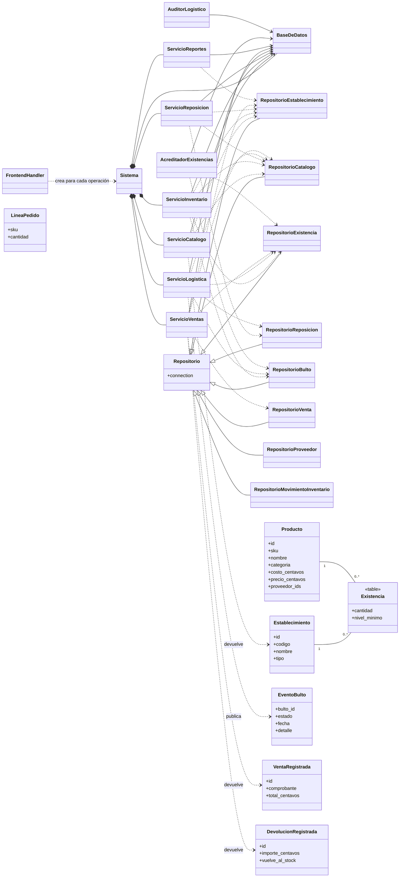
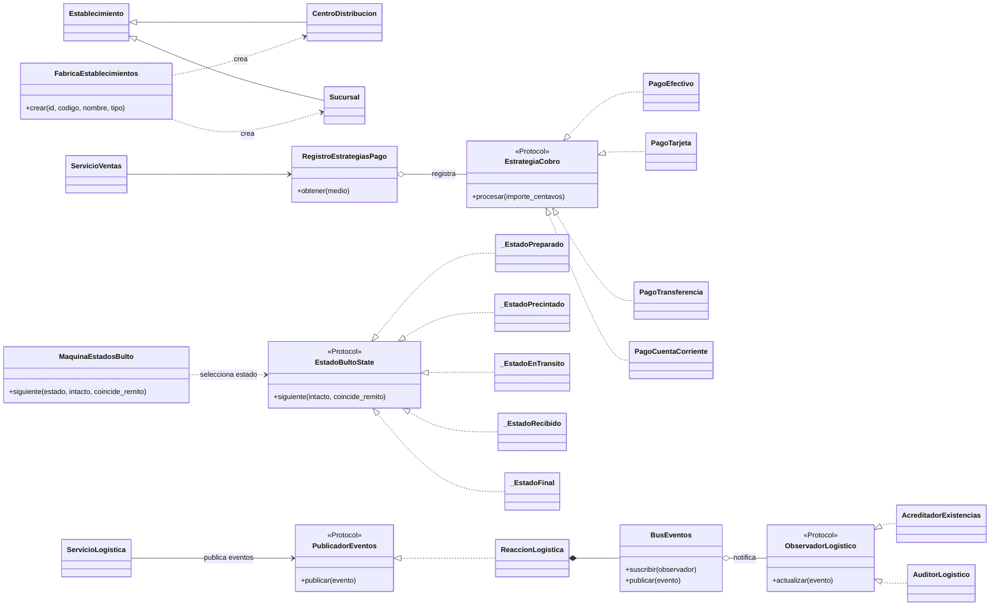

# Diagrama de clases de la implementación actual

Este diagrama describe las clases y tablas de persistencia que existen hoy en
`sistema/`; no es el diagrama objetivo de diseño. Se divide en dos vistas para
facilitar su lectura.

## Capas y dependencias

El nivel mínimo se configura por producto y establecimiento, no como una
propiedad global del producto. La entidad de persistencia `Existencia` relaciona
ambos conceptos y conserva la cantidad y el mínimo local.

Los servicios aplican las reglas de negocio y usan la conexión de `BaseDeDatos`;
las operaciones de escritura abren transacciones con ella. Los repositorios encapsulan consultas y escrituras SQLite; los
reportes y algunas actualizaciones también ejecutan SQL directamente desde el
servicio. `RepositorioProveedor` y `RepositorioMovimientoInventario` están
definidos, aunque las operaciones actuales acceden a esos datos desde otros
repositorios o consultas directas.

## Patrones y colaboraciones

La aplicación instancia la fábrica al crear establecimientos, selecciona una
estrategia de cobro por medio de pago y avanza el estado del bulto mediante
`MaquinaEstadosBulto`. En logística, `ReaccionLogistica` distribuye cada evento
a los observadores de inventario y auditoría. Al verificar la recepción, la
sucursal informa si el contenido coincide con el remito y si el precinto está
intacto; una discrepancia o un precinto violado rechaza el bulto.
