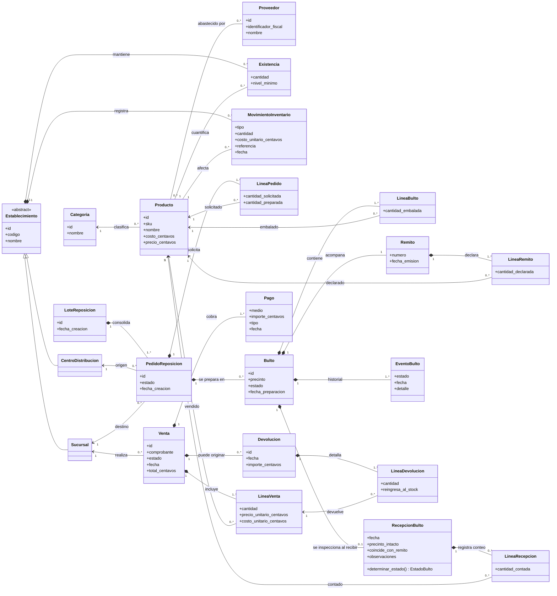
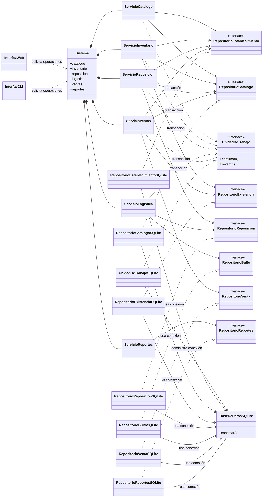
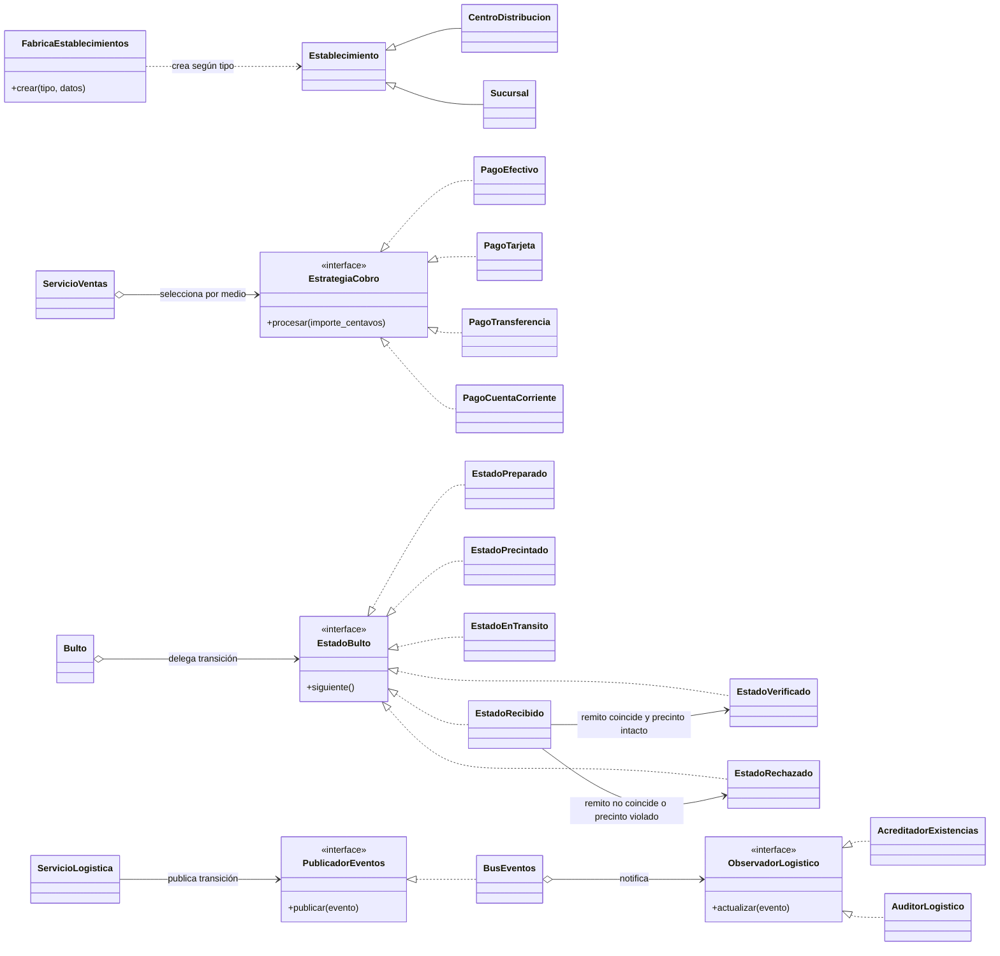

# Diagrama de clases del diseño objetivo

Este documento presenta el diseño objetivo del sistema de gestión de una red de
centros de distribución y sucursales. Describe las responsabilidades y
relaciones deseadas, no la estructura exacta de las clases que existen hoy.
Para comparar con el código implementado, consultar
[DIAGRAMA_DE_CLASES.md](./DIAGRAMA_DE_CLASES.md).

## Dominio

El stock se consulta por la combinación de establecimiento y producto. Cada
cambio de existencia genera un movimiento valorizado y auditable; el nivel
mínimo también pertenece a esa combinación, por lo que puede variar entre
establecimientos para el mismo producto. Los pedidos de un lote comparten un
centro de origen, pero cada pedido tiene una sucursal destino; se preparan en
uno o más bultos. El bulto representa el contenedor
físico y sus líneas indican lo embalado; el remito es el documento que declara
los productos y cantidades que deberían estar dentro. Al recibirlo, la sucursal
compara el contenido con el remito y registra el estado del precinto. Si el
contenido coincide y el precinto está intacto, el bulto pasa a `Verificado`; si
el contenido no coincide o el precinto está violado, pasa a `Rechazado`. Solo
los bultos verificados habilitan el ingreso de sus unidades al stock vendible.
Las devoluciones pueden ser parciales y especifican por línea si el producto
vuelve al inventario.

## Aplicación, servicios y persistencia

Las interfaces de usuario dependen de la fachada `Sistema`, no de la base de
datos. Los servicios coordinan reglas de negocio y transacciones; los contratos de
repositorio aíslan la persistencia. Los adaptadores SQLite implementan esos
contratos y usan `BaseDeDatosSQLite` para acceder a la conexión. Los reportes
consultan su propio contrato de lectura, evitando acoplar la lógica de
aplicación a consultas SQL.

## Patrones de diseño

La fábrica encapsula la creación según el tipo de establecimiento. La estrategia
de cobro permite validar cada medio de pago de forma independiente. El estado
del bulto gobierna sus transiciones válidas, incluida la verificación del
precinto. La publicación de eventos logísticos mantiene desacoplados el
movimiento de existencias y la auditoría.

## Criterios del diseño

- Mantener las reglas de negocio en servicios y el estado del dominio en
  entidades y objetos de valor.
- Hacer cumplir invariantes: ventas solo en sucursales, ajustes manuales solo en
  el centro, stock no negativo, pedidos atendidos según cantidades pendientes
  y bultos acreditados solo después de su verificación.
- Persistir movimientos, pagos y eventos para conservar trazabilidad.
- Mantener opcionales fuera de este alcance las compras sugeridas, promociones,
  listas de precios especiales, lotes de productos e inventario físico.
